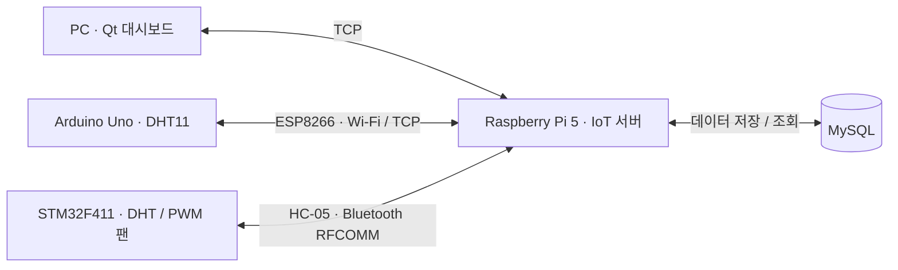

# IoTControl

📄 **[발표 자료 PDF 보기](ppt/IoTControl.pdf)**

Raspberry Pi 5, STM32, Arduino와 Qt PC 앱을 연결하는 **IoT 환경 모니터링 및 팬 제어 시스템**입니다. 현장 장치의 온도·습도를 서버 DB에 저장하고, PC 대시보드에서 측정 데이터와 접속 상태를 조회하거나 STM32 팬 속도를 제어합니다.

## 시스템 구성



| 구성 요소 | 역할 | 주요 기술 |
| --- | --- | --- |
| PC | 서버 연결·로그인, 센서 데이터 및 세션 조회, 팬 제어, Bluetooth 관리 | C++17, Qt 6 Widgets / Network |
| Raspberry Pi 5 | TCP·Bluetooth 통신, 회원 인증, DB 처리, 장치 제어 및 펌웨어 배포 | C11, Linux `epoll`, pthread, BlueZ, MySQL C API |
| Arduino Uno | DHT11 측정, ESP8266을 통한 서버 접속 및 로그인 | Arduino, PlatformIO, WiFiEspAT, EEPROM |
| STM32F411 | DHT 측정, PWM 팬 제어, Bluetooth 패킷 처리, 펌웨어 업데이트 | STM32 HAL, UART / DMA, 타이머, 플래시 |
| common | 네 환경이 공유하는 패킷 정의, 인코딩·디코딩, 스트림 수신 및 펌웨어 검사 | C |

## 주요 기능

- **센서 모니터링**: 장치별 온도·습도와 측정 기록을 저장하고, PC에서 로그인 후 5초 간격으로 DB 데이터를 조회합니다.
- **현장 측정 요청**: 연결된 모든 장치에 DHT 측정을 요청하거나, 특정 장치의 측정·DB 저장 완료 응답을 기다린 뒤 데이터를 다시 조회합니다.
- **팬 제어**: 목표 속도 `0~100%`를 DB에 저장하고, 선택한 STM32 Bluetooth 장치에 적용한 뒤 장치 응답을 확인합니다.
- **접속 상태 조회**: 서버의 TCP·Bluetooth 세션에서 연결된 STM32·Arduino 회원과 연결 방식을 조회합니다.
- **Bluetooth 관리**: 주변 장치 검색, 회원별 HC-05 페어링·등록·연결, 등록된 장치 일괄 연결을 지원합니다.
- **회원 인증**: 서버 CLI에서 장치·PC 회원을 등록하며, 비밀번호는 libsodium의 Argon2 해시로 DB에 저장합니다.
- **STM32 펌웨어 업데이트**: Bluetooth로 바이너리를 전송하고, CRC32 검사 후 부트로더가 새 앱을 설치합니다.
- **패킷 모니터링**: PC 대시보드에서 송수신 패킷 로그를 확인합니다.

## 프로젝트 구조

```text
IoTControl/
├── common/                 # 공용 프로토콜, 패킷 코덱·스트림, 펌웨어 검사
├── PC/
│   ├── Core/               # Qt 앱, 서버 연결, 로그인·조회·제어
│   ├── Panel/              # 화면별 UI 구성과 사용자 입력 처리
│   ├── screens/            # Qt Designer .ui 파일
│   ├── widget/             # 차트, 팬 표시, 테마 등 위젯
│   ├── tests/              # Qt 통신·UI 통합 테스트
│   └── examples/           # 서버 연동 설명 및 예제
├── Raspberry5/
│   ├── Main.c              # 설정 로드 및 서버 시작
│   ├── Config/             # 서버·DB 설정 읽기/쓰기
│   ├── Core/               # TCP 서버, epoll 네트워크 처리
│   ├── Database/           # DB 연결, 인증, prepared statement 쿼리
│   ├── Driver/             # Bluetooth 검색·페어링·통신
│   ├── Command/            # 서버 관리 CLI
│   ├── Packet/             # 요청 처리 및 장치 제어
│   └── Session/            # TCP·Bluetooth 세션 관리
├── Arduino/
│   ├── src/                # Arduino 앱 진입점
│   ├── lib/                # Wi-Fi, DHT, CLI, 패킷, EEPROM 모듈
│   └── platformio.ini      # Uno 빌드·업로드 설정
├── STM32/
│   ├── Core/               # CubeMX 생성 초기화 코드
│   ├── Drivers/            # HAL / CMSIS
│   ├── IoTControl/         # 앱, 드라이버, CLI, 패킷, 플래시 저장
│   ├── Bootloader/         # 별도 빌드하는 업데이트 부트로더
│   └── IoTControl.ioc      # CubeMX 하드웨어 설정
├── docs/                   # 구성도와 설명 자료
└── AGENT.md                # 프로젝트 코딩 컨벤션
```

각 구성 요소는 해당 폴더에서 독립적으로 빌드합니다. 저장소 루트에는 통합 `CMakeLists.txt`가 없습니다.

## 개발 환경

| 대상 | 필요한 도구·라이브러리 |
| --- | --- |
| Raspberry Pi 서버 | Linux, C 컴파일러, CMake 3.16 이상, pkg-config, pthread, libmariadb, libsodium, BlueZ, libsystemd, cJSON |
| 데이터베이스 | MySQL 8.4 기준 스키마와 접속 계정. 서버는 MySQL C API 호환 libmariadb로 접속 |
| PC 앱 | C++17 컴파일러, CMake, Qt 6 Widgets / Network, Ninja 또는 Qt Creator |
| PC 테스트 | Qt 6 Test / Sql, SQLite 드라이버(`QSQLITE`) |
| Arduino | PlatformIO, Arduino Uno, AT 펌웨어가 설치된 ESP8266, DHT11 |
| STM32 | STM32F411 보드, CMake 3.22 이상, Ninja, Arm GNU Toolchain, ST-Link, STM32CubeProgrammer |

## Raspberry Pi 서버 실행

### 1. 의존성 설치 및 빌드

Debian / Raspberry Pi OS 계열에서 서버 빌드 의존성을 설치합니다. MySQL 서버와 스키마는 별도로 준비합니다.

```bash
sudo apt update
sudo apt install build-essential cmake pkg-config libmariadb-dev libsodium-dev libbluetooth-dev libsystemd-dev libcjson-dev bluez

cd Raspberry5
cmake -S . -B build
cmake --build build --target IotServer --parallel
```

### 2. 서버·DB 설정

`Raspberry5/ServerConfig.json`을 직접 만들고 아래 값을 환경에 맞게 수정합니다. 모든 구역과 키가 필수입니다.

```json
{
  "server": {
    "ip": "0.0.0.0",
    "port": 5000,
    "workerCount": 4
  },
  "database": {
    "host": "127.0.0.1",
    "port": 3306,
    "user": "iot",
    "password": "YOUR_DB_PASSWORD",
    "name": "iotcontrol",
    "timeoutSeconds": 5
  }
}
```

- `server.ip`는 서버가 바인딩할 IPv4 주소입니다. `0.0.0.0`은 모든 인터페이스에서 접속을 받으며, PC·Arduino에는 Raspberry Pi의 실제 IP를 입력합니다.
- `server.port`는 `1~65535`, `workerCount`는 `1~64`, `timeoutSeconds`는 `1~3600` 범위입니다.
- `database.password`는 MySQL 접속 계정의 비밀번호입니다. 앱 로그인용 회원 비밀번호와 별개입니다.
- 설정은 **실행 시 현재 작업 디렉터리**에서 읽습니다. 파일은 Git에서 제외되며, 서버는 그룹·다른 사용자 권한이 있는 파일과 심볼릭 링크를 거부합니다.

```bash
chmod 600 ServerConfig.json
```

### 3. DB 준비

서버가 사용하는 테이블은 다음과 같습니다. 서버는 DB나 테이블을 자동 생성하지 않습니다. 설정한 DB와 계정, 아래 스키마를 먼저 준비해야 합니다.

| 테이블 | 주요 컬럼 | 용도 |
| --- | --- | --- |
| `member` | `id`, `pw_hash`, `type` | 회원 ID, 해시 비밀번호, `STM32` / `ARDUINO` / `PC` 구분 |
| `bluetooth` | `id`, `mac_address` | 회원과 Bluetooth MAC 연결 |
| `dht` | `data_id`, `id`, `temp`, `humi`, `created_at` | 회원별 센서 측정 기록 |
| `fan` | `singleton_id`, `speed` | 공용 목표 팬 속도 |
| `con` | `singleton_id`, `temp` | 공용 제어 값 |

<details>
<summary>새 개발 DB용 최소 스키마 예시</summary>

MySQL 관리 도구에서 실행합니다. 접속 계정 생성과 해당 DB의 읽기·쓰기 권한 부여는 별도로 진행합니다.

```sql
CREATE DATABASE iotcontrol CHARACTER SET utf8mb4;
USE iotcontrol;

CREATE TABLE member (
    id VARCHAR(8) PRIMARY KEY,
    pw_hash VARCHAR(255) NOT NULL,
    type ENUM('STM32', 'ARDUINO', 'PC') NOT NULL
);

CREATE TABLE bluetooth (
    id VARCHAR(8) PRIMARY KEY,
    mac_address VARCHAR(17) NOT NULL UNIQUE,
    FOREIGN KEY (id) REFERENCES member(id) ON DELETE CASCADE
);

CREATE TABLE dht (
    data_id BIGINT PRIMARY KEY AUTO_INCREMENT,
    id VARCHAR(8) NOT NULL,
    temp FLOAT,
    humi FLOAT,
    created_at TIMESTAMP DEFAULT CURRENT_TIMESTAMP,
    FOREIGN KEY (id) REFERENCES member(id) ON DELETE CASCADE
);

CREATE TABLE fan (
    singleton_id TINYINT PRIMARY KEY,
    speed INT NOT NULL
);

CREATE TABLE con (
    singleton_id TINYINT PRIMARY KEY,
    temp INT NOT NULL
);

INSERT INTO fan (singleton_id, speed) VALUES (1, 0);
INSERT INTO con (singleton_id, temp) VALUES (1, 0);
```

</details>

`fan`과 `con`은 `singleton_id = 1`인 행을 미리 생성해야 합니다. DHT 수신 시에는 인증된 장치의 회원 ID로 기록을 추가합니다. 실제 쿼리와 스키마 기준은 [RDatabaseQuery.h](Raspberry5/Database/Inc/RDatabaseQuery.h)를 참고합니다.

### 4. 실행 및 회원 등록

`Raspberry5/` 폴더에서 실행하면 설정을 읽고 DB 연결과 TCP 수신을 자동으로 시작한 뒤 관리 CLI를 엽니다.

```bash
./build/IotServer
```

서버 콘솔에서 사용할 계정을 등록합니다. 아래 비밀번호는 예시이며 실제 사용할 값으로 바꿉니다.

```text
member add pc01 YOUR_PC_PASSWORD pc
member add uno01 YOUR_UNO_PASSWORD arduino
member add stm01 YOUR_STM_PASSWORD stm32
member list
server status
```

회원 ID는 `1~8바이트`, 비밀번호는 `1~64바이트`입니다. CLI에서는 공백 없는 값을 사용합니다. 시작 시 설정 파일을 읽지 못하면 종료하며, DB 연결이나 포트 바인딩이 실패하면 콘솔에서 `server start [포트]`로 재시도할 수 있습니다.

| 관리 명령 | 기능 |
| --- | --- |
| `server status` / `server sessions` | 서버 상태 및 TCP·Bluetooth 세션 조회 |
| `server start [포트]` | 시작 실패 후 재시도 |
| `bt scan [이름]` | 주변 클래식 Bluetooth 장치 검색 |
| `bt pair <ID> <MAC> <PIN>` | 회원의 HC-05 페어링·DB 등록·연결 |
| `bt connect <ID>` / `bt connectall` | 등록된 장치 개별·일괄 연결 |
| `bt list` | 현재 연결된 Bluetooth 세션 조회 |
| `dht collect` | 연결된 장치에 DHT 측정 요청 |
| `fan set <FD> <0..100>` | 세션 FD에 팬 속도 요청 |
| `fw list` / `fw push <ID> <파일>` | STM32 펌웨어 목록 조회 및 전송 |
| `help` / `quit` | 도움말 / 서버 종료 |

## PC 앱 빌드 및 사용

Qt Creator에서 `PC/CMakeLists.txt`를 열고 Qt 6 Kit를 선택하거나, Qt Kit와 호환되는 컴파일러가 설정된 터미널에서 빌드합니다. `<QT_KIT_PATH>`는 `bin`, `lib` 등을 포함하는 Qt Kit 설치 폴더로 바꿉니다.

```powershell
cmake -S PC -B PC/build -G Ninja -DCMAKE_PREFIX_PATH="<QT_KIT_PATH>" -DCMAKE_BUILD_TYPE=Debug
cmake --build PC/build --parallel
.\PC\build\IoTControl_PC.exe
```

Windows 빌드는 `windeployqt`로 실행에 필요한 Qt DLL과 플러그인을 자동 배치합니다. Linux에서는 같은 빌드 설정을 사용할 수 있으며 실행 파일은 `./PC/build/IoTControl_PC`입니다.

1. 서버 연결 화면에서 Raspberry Pi IP와 포트를 입력합니다.
2. 서버에서 등록한 `PC` 타입 회원으로 로그인합니다.
3. 대시보드에서 온도·습도, 접속 장치, 팬 목표 속도와 패킷 로그를 확인합니다.
4. 현장 갱신을 요청하거나 Bluetooth 관리 화면에서 장치 검색·연결을 진행합니다.
5. 팬 속도를 저장하고 연결된 STM32 Bluetooth 장치를 선택해 적용 결과를 확인합니다.

팬 대상이 선택되지 않으면 목표 속도만 DB에 저장합니다. 장치를 선택하면 DB 저장 성공 후 적용 요청을 보내므로, 화면의 DB 저장 결과와 장치 적용 결과를 함께 확인합니다.

## Arduino Uno 준비

현재 핀과 통신 속도는 [Arduino/src/main.cpp](Arduino/src/main.cpp)에 정의되어 있습니다.

| 항목 | 설정 |
| --- | --- |
| DHT11 데이터 | `A0` |
| ESP8266 UART | Uno RX `D10`, TX `D11` |
| ESP8266 통신 속도 | `38400 bps` |
| USB Serial / CLI | `115200 bps` |
| 서버 접속 주소 | 현재 `10.10.16.76:5000`, 사용 환경에 맞게 수정 |

ESP8266은 WiFiEspAT와 호환되는 AT 펌웨어와 UART 설정이 필요합니다. 서버 IP·포트는 `ConnectServer()` 호출에서 변경한 뒤 빌드합니다.

저장소 루트에서 실행합니다.

```bash
pio run -d Arduino -e uno
pio run -d Arduino -e uno -t upload
pio device monitor -d Arduino -b 115200
```

시리얼 CLI에서 서버에 등록한 Arduino 계정을 저장하고 Wi-Fi에 연결합니다.

```text
member set uno01 YOUR_UNO_PASSWORD
wifi connect YOUR_SSID YOUR_WIFI_PASSWORD
wifi status
```

Wi-Fi에 연결되면 앱이 5초 간격으로 서버 연결을 시도하고 저장된 계정으로 로그인합니다. 회원 정보는 EEPROM에 저장되며, DHT 측정 결과는 서버의 `REQ_DHT` 요청에 응답합니다.

## STM32 빌드 및 펌웨어 업데이트

현재 대상은 STM32F411이며 하드웨어 설정은 [IoTControl.ioc](STM32/IoTControl.ioc)에서 확인할 수 있습니다.

| 항목 | 설정 |
| --- | --- |
| Bluetooth HC-05 / ZS-040 | USART1: TX `PA9`, RX `PA10`, `9600 bps` |
| 시리얼 CLI | USART2: TX `PA2`, RX `PA3`, `115200 bps` |
| DHT 데이터 | `PB6`, TIM4 CH1 |
| 팬 PWM | `PA6`, TIM3 CH1, `25 kHz` |

`arm-none-eabi-gcc`와 Ninja를 PATH에 설정한 뒤 부트로더와 앱을 각각 빌드합니다.

```bash
cd STM32/Bootloader
cmake --preset Release
cmake --build --preset Release

cd ..
cmake --preset Debug
cmake --build --preset Debug
```

| 영역 | 시작 주소 | 용도 |
| --- | --- | --- |
| 부트로더 | `0x08000000` | 16 KiB, 업데이트 설치 및 앱 실행 |
| 앱 | `0x08004000` | 최대 112 KiB, `IoTControl.elf` |
| 업데이트 대기 영역 | `0x08020000` | 128 KiB, 수신한 이미지와 검증 헤더 |
| 장치 설정 | `0x08060000` | 128 KiB, `SData` 저장 |

최초 설치 시 ST-Link / STM32CubeProgrammer로 `STM32/Bootloader/build/Release/IoTBootloader.elf`와 `STM32/build/Debug/IoTControl.elf`를 기록합니다. ELF에는 각 시작 주소가 포함되어 있습니다. `.bin`을 사용할 때는 위 주소를 직접 지정합니다. 현재 앱은 부트로더 뒤에서 실행하도록 링크되어 있어 부트로더 설치가 필요합니다.

STM32 시리얼 CLI에서 `member set stm01 YOUR_STM_PASSWORD`로 계정을 저장하고, 서버 CLI의 `bt pair <ID> <MAC> <PIN>`으로 장치를 등록·연결합니다.

이후 펌웨어 배포는 다음 순서로 진행합니다.

1. [SDefine.h](STM32/IoTControl/Common/SDefine.h)의 `FIRMWARE_VERSION` 값을 올리고 앱을 다시 빌드합니다.
2. 생성된 `STM32/build/Debug/IoTControl-v<버전>.bin`을 서버의 `/srv/samba/firmware/stm32/`에 복사합니다. Samba 공유를 사용할 경우 별도로 공유 폴더를 구성합니다.
3. 서버 CLI에서 `fw list`로 이미지와 버전을 확인합니다.
4. `fw push stm01 IoTControl-v<버전>.bin`으로 연결된 STM32에 전송합니다.

장치는 `BEGIN → CHUNK → END` 순서로 이미지를 수신하고 CRC32를 검증한 뒤 재부팅합니다. 부트로더는 대기 이미지를 앱 영역에 설치합니다. 플래시 배치와 검사 기준은 [IoTFirmware.h](common/IoTFirmware.h)에 정의되어 있습니다.

## 통신 프로토콜

TCP와 Bluetooth는 같은 바이너리 프레임을 사용합니다. 공용 정의는 [IoTProtocol.h](common/IoTProtocol.h), 페이로드는 [IoTPacket.h](common/IoTPacket.h), 직렬화 함수는 [IoTPacketCodec.h](common/IoTPacketCodec.h)에 있습니다.

```text
8바이트 헤더                                      페이로드
┌──────────┬──────────┬──────────┬──────────┬──────────────────┐
│ cmd: u16 │ len: u16 │ rsv: u16 │ crc: u16 │ 명령별 데이터    │
└──────────┴──────────┴──────────┴──────────┴──────────────────┘
```

- 다중 바이트 값은 little-endian이며, 헤더의 `length`는 페이로드 길이입니다.
- `REQ`는 요청, `ACK`는 결과 응답, `NFY`는 응답을 요구하지 않는 알림입니다. `ACK`의 첫 바이트는 결과 코드입니다.
- 프레임은 헤더 앞 6바이트와 페이로드에 대한 CRC-16/CCITT-FALSE로 검사합니다. 기본 최대 페이로드는 512바이트입니다.
- 연결별로 한 번에 하나의 요청에 대한 ACK를 기다립니다. 스트림 수신기는 나뉘어 들어오거나 연속으로 들어온 프레임을 조립합니다.
- 주요 메시지는 로그인, DHT 조회·수집·개별 갱신, 팬 조회·저장·적용, 세션 조회, Bluetooth 관리, 펌웨어 전송입니다.

## 테스트

PC 통합 테스트는 `IOT_BUILD_TESTS=ON`으로 활성화합니다. Qt Test / Sql 모듈과 SQLite 드라이버가 필요합니다.

```powershell
cmake -S PC -B PC/build-tests -G Ninja -DCMAKE_PREFIX_PATH="<QT_KIT_PATH>" -DCMAKE_BUILD_TYPE=Debug -DIOT_BUILD_TESTS=ON
cmake --build PC/build-tests --parallel
ctest --test-dir PC/build-tests --output-on-failure
```

현재 테스트 대상은 `server_connection_tests`, `server_login_tests`, `bluetooth_operations_tests`, `dht_query_tests`입니다. TCP 연결·로그인, 분할 프레임과 오류 응답, DHT 조회·갱신, 팬 DB 저장·장치 응답, 접속 상태 및 Bluetooth 관리 UI를 검증합니다. 실제 센서·팬·무선 연결과 부트로더 설치는 대상 하드웨어에서 확인해야 합니다.

## 동작 시 참고 사항

- **DB 조회와 새 측정은 별도 동작입니다.** PC의 5초 주기 조회는 저장된 데이터를 읽습니다. 전체 DHT 수집 ACK는 장치에 요청을 보냈다는 의미이며, 개별 갱신 ACK는 측정 응답과 DB 저장 결과를 반영합니다.
- **팬 값은 공용 단일 행입니다.** `fan.singleton_id = 1`은 장치별 설정이나 실제 RPM이 아닌 목표 속도(%)를 저장합니다.
- **TCP에는 암호화가 없습니다.** 회원 비밀번호의 DB 저장에는 해시를 사용하지만 로그인 요청은 평문으로 전송되므로 신뢰할 수 있는 내부망에서 사용합니다.
- **설정 변경 후에는 서버를 재시작합니다.** IP·포트·워커 등 시작 설정을 다시 적용하려면 프로세스를 재시작합니다.
- **Bluetooth 작업은 시간이 걸릴 수 있습니다.** 검색·페어링·일괄 연결·펌웨어 전송 중에는 서버 CLI가 완료를 기다립니다. Pi Bluetooth 어댑터와 BlueZ 서비스 상태를 확인합니다.

개발 규칙은 [AGENT.md](AGENT.md)를 따릅니다. Arduino·STM32에서는 동적 메모리 할당을 추가하지 않고, 헤더에는 `static` 변수·함수를 선언하거나 정의하지 않습니다.
